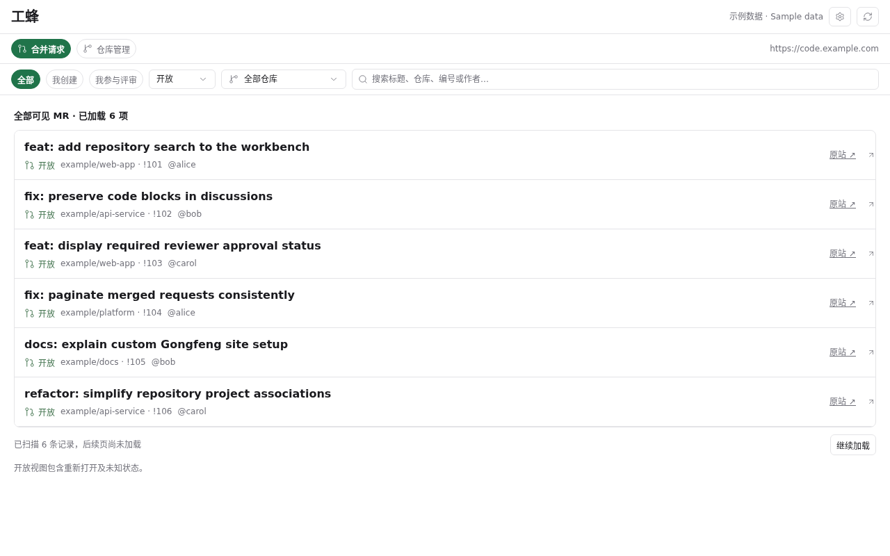

# Paseo 工蜂

在 Paseo 中管理工蜂仓库和合并请求。设置工蜂站点地址与 Private Token 后，即可搜索仓库、关联本地 Paseo 项目、查看当前及历史 MR。

当前为源码预览版，要求站点兼容本插件使用的工蜂 OpenAPI v3。自定义地址解决连接目标配置，不保证不同部署版本的接口完全一致；公网 SaaS 的真实账号完整链路尚未验收。

## 功能



截图使用示例数据，界面目前为简体中文。

- MR 看板：默认全部可见 MR，也可筛选我创建／我参与评审；支持开放／已合入／已关闭／全部状态、关联仓库筛选（全部视图直接查询选中仓库）及标题／仓库／编号／作者搜索，显示所有者账号。
- 悬浮详情抽屉：统一卡片展示描述、评审、TAPD 与 CI，右上角一次刷新全部内容；支持描述宽弹窗、讨论 Markdown／机器人徽章渲染和带行号的代码差异；操作按钮采用紧凑尺寸，窄屏保留触控空间。
- 代码评审：显示普通／必要评审人的规则和进度，头像与分组名单支持悬浮搜索多选、移除及类型调整（头像以工蜂返回为准）；当前账号是评审人时显示“同意”按钮，打开弹窗选择同意、需要修改、明确拒绝或评论，填写选填附言，确认后提交。
- 仓库管理：搜索添加仓库，每条仓库关联具体 Paseo 项目，或克隆并登记为新项目。每个项目最多关联一个仓库，同一仓库可关联多份本地项目。
- 里程碑：默认汇总已添加仓库，可筛选状态／仓库并搜索已加载标题与描述；悬浮详情展示关联议题和 MR。支持新建、编辑、关闭／重开、确认后删除，以及关联草稿、移除和明确确认后的迁移；Issue 关闭数、MR 合入数及关闭未合入数分别统计，分页范围明确。
- 自定义站点：填写 HTTPS 根地址，凭据、关联与操作历史按站点保存。每次使用一个站点，各授权客户端共用该站点身份。

插件直接调用 OpenAPI，不使用工蜂 MCP。人员调整、评审意见、里程碑管理及关联变更仅在用户确认后回写；不合入 MR 或触发远程流水线。插件不提供 Agent Review 派发。

## 安装与配置

本版使用Paseo现有创建Hook和官方0.12.0 SDK，要求Paseo 0.12.0+；MCP还要求所选provider支持HTTP连接。要求本机 Git、Paseo CLI，以及 daemon 能访问所填工蜂站点。插件属于可信代码，在 daemon 和客户端运行，安装前请审阅源码。

在已启用插件的 daemon 中安装：

```sh
paseo plugin install github:hulkzzhou1/paseo-gongfeng --ref v0.3.0
```

1. 打开工作台右上角“工蜂设置”，填写站点根地址（例如 `https://code.example.com`），不含 `/api/v3` 或仓库路径。
2. 输入该站点的 Private Token，点击“验证并保存”。新站点必须提供自己的 Token；已保存站点可留空复用对应凭据。验证失败保留原配置。
3. 打开“仓库管理”，搜索并添加仓库，再关联本地项目。自动匹配只作为候选，需明确选择项目。
4. 打开 MR 详情查看描述、差异、讨论及评审状态。

Token 只保存在服务器，不回显到客户端，也不作为 Git 凭据。克隆使用该站点主机的 Git SSH 地址及标准 SSH 端口，需要独立配置非交互 SSH 认证与主机密钥。自定义 SSH 主机或端口尚未提供配置。

## 数据与限制

凭据位于 `$PASEO_HOME/secrets/gongfeng-workbench/private-token`，目录权限 0700、文件 0600；仓库关联、克隆记录位于对应 `plugin-data/gongfeng-workbench`。旧安装自动将已有数据识别为原站点数据。切换站点保留各自记录，不向新地址发送旧站点 Token，不跟随 API 重定向。

克隆不自动下载子模块与 LFS 内容。CI 仅显示提交检查摘要，不承诺完整流水线日志。TAPD 链接只在已知映射的部署中生成，其他站点保留数据并提示链接不可用。描述支持基础 Markdown，代码差异提供增删着色，没有语言语法高亮。全局关键词搜索逐页扫描可见 MR，每次最多 100 条；界面提示已搜索范围，后续内容需点击继续搜索，不将首批无匹配当作全局无结果。

人员编辑每次最多管理 100 人，候选来自有项目权限的成员。必要评审人能否调整由工蜂权限及项目规则决定；多步保存可能部分成功，失败后读取实际名单，不自动回滚或重试写请求。提交意见前核对源提交和评审版本；工蜂接口尚无已验证的原子版本条件，核对与写入仍有短暂竞争窗口。真实业务 MR 的远程写入尚未验收。

克隆失败产生的目录会保留供核验与恢复；解除关联保留代码。旧版本产生的 Review Agent、工作区和历史文件不删除，可通过 Paseo 原有入口查看已有 Agent，但插件不再提供派发或恢复入口。完整原生手机端与所有部署版本未验收；社区目录收录状态以官方审核结果为准。

## 开发

使用 Node.js 24、npm 和 Git，在源码目录执行：

```sh
npm ci --include=dev --ignore-scripts
npm run check
npm run hooks:install
paseo plugin install .
```

`npm run check` 检查本地任务状态、TypeScript 与自动化测试；测试使用临时数据和模拟 HTTP，不需要真实 Token 或模型。更改后使用 `paseo plugin reload gongfeng-workbench`，不需要重启 daemon。

采用 [MIT 许可证](LICENSE)。本项目独立实现工蜂接口层，参考现有 Paseo 插件的交互组织，未复制 GitHub 插件的代码或实质部分。

MR 概览支持确认后关闭开放 MR、重新打开已关闭 MR；重开可能按最新 OWNERS 重置评审规则。已合入／锁定／未知状态不提供此操作。权限由工蜂校验；状态更新前复核版本、更新后回读，结果未知时不自动重发。

## 可选 MCP 接入

工蜂设置的“向 Agent 提供工蜂 MCP”开关默认关闭。开启且已连接工蜂时，仅向当前host／站点已有效关联工蜂仓库的Paseo项目，通过 `agent.create` Hook给新建Agent注入本地HTTP MCP；保留原有Agent配置和其他MCP，同名 `gongfeng-workbench` 连接不覆盖。工具覆盖仓库／本地项目关联、MR读取与人工评审、关闭／重开、里程碑管理。写入仍需用户授权与确认。

归属通过宿主项目／工作区SDK核对，支持关联项目的worktree和子目录；未关联、关联失效、嵌套的未关联项目或归属不明确时不注入。关联解除只影响之后的自动注入，不改写已有Agent配置。

关闭或卸载会停止插件服务，但不删除或更新已创建Agent中的连接；插件重载／切换凭据后，旧连接可能失效，需新建Agent采用新定义。不会通过 `agent.session_open` 注入MCP，也不主动重启已有Agent。工蜂Token不进入Agent配置或环境；调用结果可能由Agent的模型供应商处理。

本版使用Paseo现有创建Hook，不需要Hosted MCP统一管理接口。新Hook路径已完成受控RPC／标准MCP测试和隔离fake provider验证，尚未重新验证真实provider；原生手机及真实MR状态写入仍待验收。详见 [验证范围](docs/validation.md)。
